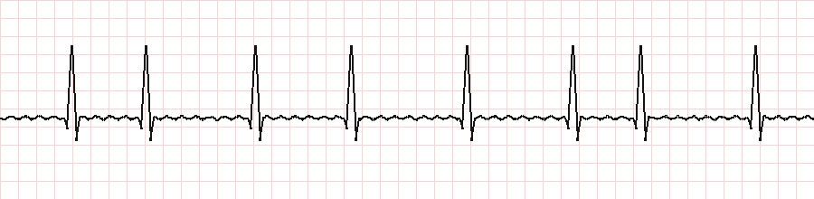
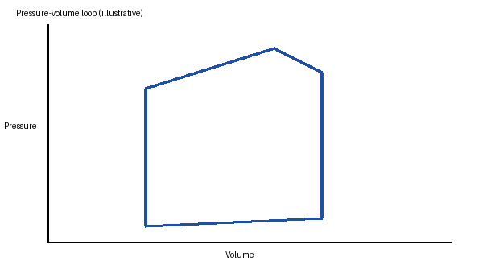

## Question
ID: sample-cardio-001
Tags: Cardiology, Pharmacology, Arrhythmias

### Stem
A 67-year-old man comes to the emergency department because of palpitations for 2 hours. His pulse is 148/min and irregularly irregular, and blood pressure is 128/76 mm Hg. A rhythm strip is shown.

Which of the following is the most appropriate medication to control his heart rate?

### Choices
A. Adenosine
B. Amiodarone
C. Diltiazem
D. Digoxin as monotherapy
E. Procainamide

### Answer
C

### Explanation
This hemodynamically stable patient has **atrial fibrillation with rapid ventricular response**. First-line rate control is a nondihydropyridine calcium channel blocker such as **diltiazem**, or a beta blocker.

| Choice | Why not |
|---|---|
| Adenosine | Only transiently blocks the AV node |
| Amiodarone | Rhythm-control agent with significant toxicity |
| Digoxin | Slow onset; adjunct rather than first line |
| Procainamide | Reserved for preexcited atrial fibrillation |

### Educational Objective
Stable atrial fibrillation with rapid ventricular response is treated first with a beta blocker or nondihydropyridine calcium channel blocker.

## Question
ID: sample-cardio-002
Tags: Cardiology, Physiology

### Stem
The pressure-volume loop of a patient's left ventricle is shown below.

Stroke volume is best calculated by which of the following?

### Choices
A. End-diastolic volume minus end-systolic volume
B. End-systolic volume minus end-diastolic volume
C. Cardiac output multiplied by heart rate
D. Mean arterial pressure divided by heart rate

### Answer
A

### Explanation
Stroke volume is the width of the loop: $SV = EDV - ESV$. Ejection fraction follows as

$$EF = \frac{EDV - ESV}{EDV}$$

Cardiac output is $CO = SV \times HR$, so choice C reverses that relationship.

## Question
ID: sample-neuro-001
Tags: Neurology, Pharmacology, Epilepsy
Source: YouWorld Sample Set (Neurology)

### Stem
A 24-year-old woman with juvenile myoclonic epilepsy asks about switching from valproate because she plans pregnancy. Which of the following is the most appropriate alternative?

### Choices
A. Carbamazepine
B. Lamotrigine
C. Phenytoin
D. Ethosuximide

### Answer
B

### Explanation
**Lamotrigine** is effective for generalized epilepsies and has a far lower teratogenic risk than valproate. Carbamazepine and phenytoin can worsen myoclonic and absence seizures, and ethosuximide treats absence seizures only.

## Question
ID: sample-renal-001
Tags: Nephrology, Physiology

### Stem
Which segment of the nephron reabsorbs the largest fraction of filtered sodium?

### Choices
A. Proximal convoluted tubule
B. Thick ascending limb
C. Distal convoluted tubule
D. Collecting duct

### Answer
A

### Explanation
The proximal convoluted tubule reabsorbs about two thirds of filtered sodium.
